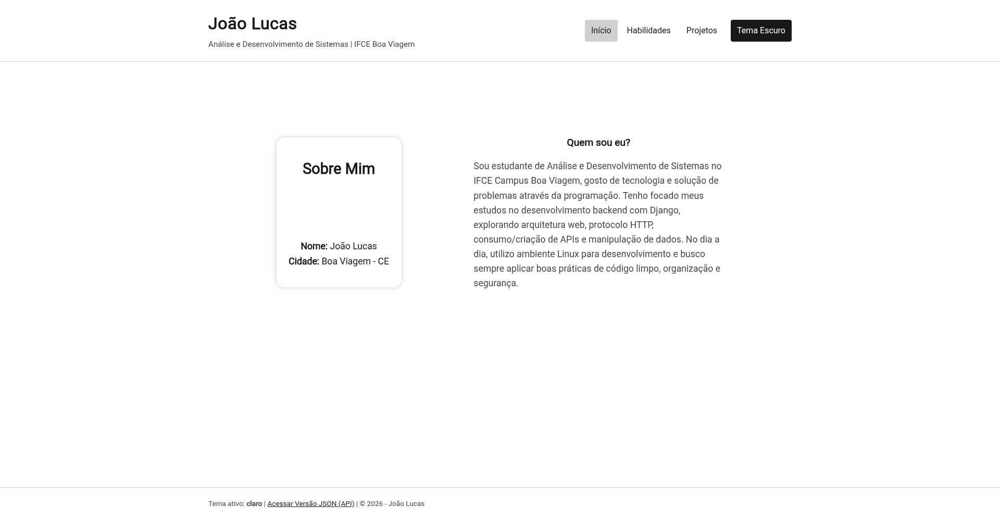
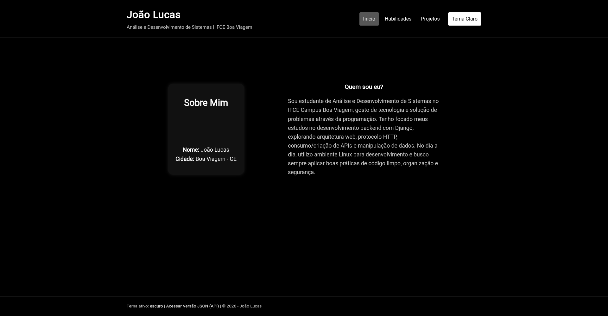

# Perfil do Estudante: versão 1

**Autor(a):** _João Lucas Teixeira Leite_

## Como executar

```
cd projeto/v1
php -S localhost:8000 -d display_errors=1 -d output_buffering=0
```

Abra http://localhost:8000

## Telas

| Tema claro | Tema escuro |
|---|---|
|  |  |

## 1. Mapa de rotas

Complete com todas as rotas do seu projeto.

| URL | O que mostra | Status |
|---|---|---|
| `/` | | |
| `/?pagina=habilidades` | | |
| `/?pagina=projetos` | | |
| `/?pagina=projeto&id=1` | | |
| `/?pagina=projeto&id=99` | | |
| `/?pagina=qualquercoisa` | | |
| `/?tema=escuro` | | |
| `/?formato=json` | | |

## 2. Saídas do terminal

**2.1 Uma página que existe:** `curl.exe -i "http://localhost:8000/?pagina=habilidades"` (cole só até o início do HTML)

```text
HTTP/1.1 200 OK
Host: localhost:8000
Date: Tue, 13 Oct 2026 16:03:03 GMT
Connection: close
X-Powered-By: PHP/8.5.10
Content-type: text/html; charset=UTF-8
```

**Explicação:**

_
1. Fala a versão do protocolo HTTP utilizada, 200 o código de status HTTP informando que a conexão está OK
2. O endereço e a porta do servidor para onde a requisição foi enviada
3. A data e a hora exatas do envio da resposta
4. Informa que a conexão será TCP será fechada imediatamente após a entrega desta resposta
5. Cabeçalho informativo que revela a linguagem e a versão do PHP
6. Informa o conteúdo (HTML) define a codificação de caracteres como UTF-8
_

**2.2 Uma página que não existe:** `curl.exe -i "http://localhost:8000/?pagina=projeto&id=99"` (cole só até o início do HTML)

```text
HTTP/1.1 404 Not Found
Host: localhost:8000
Date: Tue, 13 Oct 2026 16:11:46 GMT
Connection: close
X-Powered-By: PHP/8.5.10
Content-type: text/html; charset=UTF-8
```

**Explicação:**

_
1. É a linha de status HTTP. O código 404 (gerado pela instrução http_response_code(404) do PHP) informa oficialmente ao cliente/navegador que a página ou o ID do projeto solicitado não existe no servidor.
2. Indica o nome do domínio e a porta de rede do servidor web local que recebeu e processou a requisição.
3. É o carimbo de data e hora exato em que o servidor PHP gerou e enviou essa resposta (em formato UTC/GMT).
4. Avisa ao curl que a conexão TCP entre o cliente e o servidor será encerrada imediatamente após o envio do corpo da resposta, sem mantê-la aberta para novas requisições.
5. Cabeçalho informativo enviado automaticamente pelo PHP indicando a linguagem e a versão exata do interpretador em execução no servidor.
6. Especifica o tipo de mídia (MIME type) do conteúdo transmitido logo a seguir — neste caso, um documento HTML codificado em UTF-8 (permitindo acentos e caracteres especiais no texto de erro).
_

**2.3 A troca de tema:** `curl.exe -i "http://localhost:8000/?tema=escuro"` (cole só até a linha do `<body>`)

```text
HTTP/1.1 200 OK
Host: localhost:8000
Date: Tue, 13 Oct 2026 16:16:28 GMT
Connection: close
X-Powered-By: PHP/8.5.10
Set-Cookie: tema=escuro; expires=Thu, 12 Nov 2026 16:16:28 GMT; Max-Age=2592000; path=/
Content-type: text/html; charset=UTF-8

<!DOCTYPE html>
<html lang="pt-BR">
<head>
  <meta charset="UTF-8">
  <meta name="viewport" content="width=device-width, initial-scale=1">
  <title>Início - Perfil do Estudante</title>
  <link rel="stylesheet" href="/estilo.css">
</head>
```

**Explicação (qual cabeçalho grava o tema e como o PHP sabe o tema na próxima requisição):**

_Set-Cookie. O servidor ordena a gravação: A função setcookie() envia o cabeçalho mandando o navegador salvar a preferência no computador do usuário. O navegador devolve o dado e nas requisições seguintes, o próprio navegador envia o cabeçalho Cookie para o servidor. O PHP lê a variável: O interpretador pega esse cabeçalho e preenche a superglobal $_COOKIE['tema']. O código aplica a escolha: A linha $tema = $_GET['tema'] ?? $_COOKIE['tema'] ?? 'claro' detecta que não há nada na URL e usa o valor salvo em $_COOKIE['tema']._

**2.4 A API:** `curl.exe -i "http://localhost:8000/?formato=json"`

```text
HTTP/1.1 200 OK
Host: localhost:8000
Date: Wed, 14 Oct 2026 00:22:36 GMT
Connection: close
X-Powered-By: PHP/8.5.10
Content-Type: application/json; charset=utf-8

{
    "perfil": {
        "nome": "João Lucas",
        "curso": "Análise e Desenvolvimento de Sistemas",
        "campus": "IFCE Boa Viagem",
        "cidade": "Boa Viagem - CE",
        "apresentacao": "Sou estudante de Análise e Desenvolvimento de Sistemas no IFCE Campus Boa Viagem, gosto de tecnologia e solução de problemas através da programação. Tenho focado meus estudos no desenvolvimento backend com Django, explorando arquitetura web, protocolo HTTP, consumo\/criação de APIs e manipulação de dados. No dia a dia, utilizo ambiente Linux para desenvolvimento e busco sempre aplicar boas práticas de código limpo, organização e segurança.",
        "habilidades": [
            "Javascript",
            "HTML5",
            "CSS3",
            "Django"
        ]
    },
    "projetos": {
        "1": {
            "titulo": "Backend do AprendeMais",
            "descricao": "Banco de Dados do projeto AprendeMais para armazenar dados de componentes de escolas de ensino fundamental",
            "tecnologias": "Docker, Postgresql, Django"
        },
        "2": {
            "titulo": "Lista de Tarefas (To-Do List)",
            "descricao": "Interface simples para adicionar, marcar e remover tarefas do dia a dia.",
            "tecnologias": "HTML5, CSS3, JavaScript"
        },
        "3": {
            "titulo": "Perfil do Estudante v1",
            "descricao": "Aplicação Web Front Controller completa com roteamento via Query String, gerenciamento de tema via cookies e API JSON.",
            "tecnologias": "PHP 8, HTML5, CSS3, Cookies, JSON"
        }
    }
}                                   
```

**Explicação:**

_Serialização via json_encode(): O bloco de dados entre chaves { ... } é o resultado da conversão dos arrays PHP $perfil e $projetos para a sintaxe JSON. 

"perfil": Agrupa os atributos do estudante (nome, curso, campus, apresentação) e converte o array PHP de habilidades em um array numérico em JSON (["Javascript", "HTML5", "CSS3", "Django"]).

"projetos": Mapeia os projetos associativos numerados ("1", "2", "3"), mantendo a integridade dos atributos de cada um (titulo, descricao, tecnologias).
_

**2.5 Log do servidor** das quatro requisições acima

```text
1. Saída de curl.exe -i "http://localhost:8000/?pagina=habilidades"
    [Tue Oct 13 21:35:12 2026] [::1]:55736 Accepted
    [Tue Oct 13 21:35:12 2026] [::1]:55736 [200]: GET /?pagina=habilidades
    [Tue Oct 13 21:35:12 2026] [::1]:55736 Closing

2. Saída de curl.exe -i "http://localhost:8000/?pagina=projeto&id=99"
    [Tue Oct 13 21:36:47 2026] [::1]:48978 Accepted
    [Tue Oct 13 21:36:47 2026] [::1]:48978 [404]: GET /?pagina=projeto&id=99
    [Tue Oct 13 21:36:47 2026] [::1]:48978 Closing

3. Saída de curl.exe -i "http://localhost:8000/?tema=escuro"
    [Tue Oct 13 21:38:27 2026] [::1]:56242 Accepted
    [Tue Oct 13 21:38:27 2026] [::1]:56242 [200]: GET /?tema=escuro
    [Tue Oct 13 21:38:27 2026] [::1]:56242 Closing

4. Saída de curl.exe -i "http://localhost:8000/?formato=json"
    [Tue Oct 13 21:40:47 2026] [::1]:56940 Accepted
    [Tue Oct 13 21:40:47 2026] [::1]:56940 [200]: GET /?formato=json
    [Tue Oct 13 21:40:47 2026] [::1]:56940 Closing
```

**Explicação:**

_
1. O cliente conecta pela porta 55736. O PHP identifica que a página habilidades existe no switch/if-else, processa os dados do array e retorna o status 200 OK. Em seguida, a conexão é encerrada.

2. O cliente conecta pela porta 48978. O script checa a existência do ID com isset($projetos[99]). Como a chave 99 não existe no array, o PHP executa http_response_code(404). O servidor registra o status 404 Not Found no log e fecha a conexão.

3. O cliente conecta pela porta 56242. O PHP valida a variável no parâmetro ?tema=, dispara a função setcookie() para gravar o valor no navegador e devolve a página com status 200 OK, finalizando a conexão.

4. O cliente conecta pela porta 56940. O script intercepta o parâmetro formato=json, define o cabeçalho Content-Type: application/json, imprime a string serializada por json_encode() e é interrompido pelo exit. O servidor responde com 200 OK e encerra a conexão.
_

## 3. Onde usei cada conceito

| Conceito | Linha(s) do `index.php` | Para que usei |
|---|---|---|
| Array associativo | 6–31 | Para guardar os dados do perfil e dos projetos, organizados por chaves e valores. |
| `$_GET` e `??` | 33, 41, 50 e 61 | Para ler tema, formato, página e ID pela URL, usando valores padrão quando o parâmetro não existe. |
| `if` / `elseif` / `else` | 37, 41, 54–72 e 98–102 | Para validar o tema, escolher a resposta JSON, controlar as rotas e alternar o texto do botão de tema. |
| `htmlspecialchars` | 2–3 | Para escapar os dados exibidos no HTML e evitar que caracteres especiais sejam interpretados como código. |
| `setcookie` e `$_COOKIE` | 33 e 37–38 | Para ler o tema salvo anteriormente e gravar a nova preferência do usuário por 30 dias. |
| `http_response_code(404)` | 66–74 | Para indicar erro quando o projeto não existe ou quando a rota informada é inválida. |
| `header` e `json_encode` | 41–47 | Para definir o tipo da resposta como JSON e converter os arrays PHP em uma resposta JSON formatada. |
| `implode` e `count` | 131–133 | Para contar as habilidades cadastradas e mostrar todas em uma única frase separada por pontos. |

## 4. Decisões e dificuldades

**4.1 Por que toda a lógica PHP fica no topo do arquivo, antes do HTML?**

_Para ter prioridade, caso o html estivesse acima do php, cookies e os arrays de projetos por exemplo, não seriam carregados e causaria problemas._

**4.2 Por que o tema escolhido na URL precisa ser validado?**

_A validação é fundamental para a integridade da aplicação e para a segurança. A validação garante que apenas valores permitidos sejam aceitos, previnindo assim, scripts maliciosos em URLs por exemplo

**4.3 Qual foi a maior dificuldade e como você resolveu?**

_Acredito que foi a estrutura php inteira, foi a minha primeira vez utilizando o php de forma mais profunda assim. A manipulação de rotas e a sintaxe php por exemplo, foi algo que me deixou um pouco confuso no inicio, porém ao estudar e procurar entender como funciona me senti facinado por essa linguagem._
